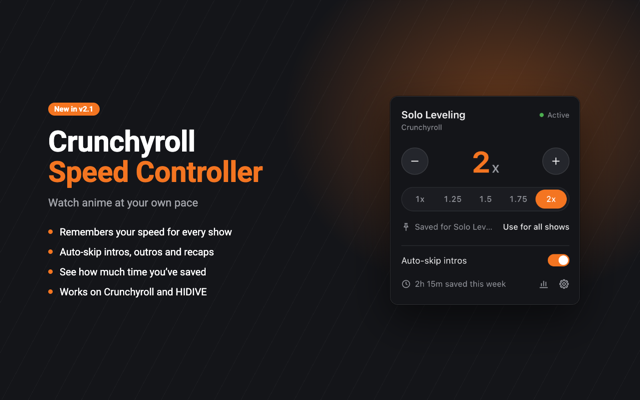

<p align="center">
  
</p>

<h1 align="center">Crunchyroll Speed Controller</h1>

<p align="center">
  <strong>Watch anime at your own pace</strong>
</p>

<p align="center">
  <a href="#installation">Install</a> •
  <a href="#features">Features</a> •
  <a href="#usage">Usage</a> •
  <a href="#keyboard-shortcuts">Shortcuts</a> •
  <a href="#contributing">Contributing</a>
</p>

<p align="center">
  
  
  
  
</p>

<p align="center">
  
</p>

---

## Features

| Feature | Description |
|---------|-------------|
| **Speed Control** | Adjust playback from 0.25x to 4.0x |
| **Auto-Skip Intro/Outro** | Automatically skips openings, endings, recaps & credits |
| **Multi-Site** | Works on both Crunchyroll and HIDIVE |
| **Stats Dashboard** | Full page with time-saved graph, watch streaks, top series & milestone badges |
| **Custom Shortcuts** | Rebind keyboard shortcuts on the settings page |
| **Quick Presets** | One-click presets: 1x, 1.25x, 1.5x, 1.75x, 2x, plus fine −/+ controls |
| **On-Screen Indicator** | See current speed with auto-hiding overlay |
| **Remember Speed** | Persists your preferred speed across sessions |
| **Per-Show Speed** | Remembers a different speed for each show, automatically |
| **Customizable Step** | Choose speed increment: 0.05x, 0.10x, or 0.25x |
| **Send Feedback** | Built-in feedback form on the settings page to report bugs or request features |
| **Dark Theme** | Seamlessly matches Crunchyroll's aesthetic |

---

## Installation

### Option 1: Chrome Web Store
> **Status:** Pending Review

Once approved, install directly from the Chrome Web Store (link coming soon).

### Option 2: Manual Install (Developer Mode)

<details>
<summary><strong>Click to expand installation steps</strong></summary>

#### Step 1: Download
```bash
git clone https://github.com/flyy4abrownguy/crunchyroll-speed-controller.git
```
Or [download ZIP](https://github.com/flyy4abrownguy/crunchyroll-speed-controller/archive/refs/heads/main.zip) and extract.

#### Step 2: Open Chrome Extensions
Navigate to `chrome://extensions` in your browser.

#### Step 3: Enable Developer Mode
Toggle **"Developer mode"** in the top-right corner.

#### Step 4: Load Extension
1. Click **"Load unpacked"**
2. Select the `crunchyroll-speed-controller` folder (containing `manifest.json`)

#### Step 5: Done!
The extension icon appears in your toolbar. Navigate to [Crunchyroll](https://crunchyroll.com) and enjoy!

</details>

---

## Usage

### Popup Controls

The popup has two states.

**Watching** (an episode with a video is open on Crunchyroll or HIDIVE):

- **Speed** — Big speed number with **−** / **+** buttons (step size comes from your Speed step setting)
- **Presets** — 1x · 1.25 · 1.5 · 1.75 · 2x
- **Saved for {Show}** — Speed is remembered for each show automatically. **Use for all shows** clears the per-show speeds
- **Auto-skip intros** — Toggle right in the popup
- **Time saved this week**, plus shortcuts to the stats and settings pages

**Idle** (anywhere else): time saved this week, intros skipped and streak, all-time saved, your top show, and the auto-skip toggle. On Crunchyroll or HIDIVE it also shows **Starting speed**, the speed shows without their own saved speed start at. The first time you open the popup it skips the empty stats and asks you to pick a starting speed, then open an episode.

A show with no saved speed starts at the last speed you chose. Tabs opened before an update need a reload before speed controls turn on.

### Settings

Settings live on the options page (the stats page). Open it from the settings icon in the popup.

| Setting | Description |
|---------|-------------|
| **Remember speed** | Save your speed across sessions, per show |
| **Show speed overlay on video** | Toggle the on-screen speed display |
| **Speed step for − / +** | Choose the increment: 0.05x, 0.10x, 0.25x |
| **Auto-skip intros** | Automatically click Skip Intro / Skip Outro buttons |

The same page has the full **Stats Dashboard** — a 30-day activity graph, watch streaks, your top series, and milestone badges — along with **Keyboard shortcuts** and **Send feedback** (Bug, Feature or General).

### Customizing Shortcuts

Open the settings page and use the **Keyboard shortcuts** section to rebind the in-page keys: click a shortcut, then press your new combination. These work while watching without leaving the page.

---

## Keyboard Shortcuts

Use these shortcuts while watching on Crunchyroll:

| Action | Shortcut |
|--------|----------|
| Increase speed | `Shift` + `>` |
| Decrease speed | `Shift` + `<` |
| Reset to 1.0x | `Shift` + `?` |

### Global Shortcuts (Customizable)

These work even when the page isn't focused. Customize them at `chrome://extensions/shortcuts`:

| Action | Default |
|--------|---------|
| Increase speed | `Alt` + `.` |
| Decrease speed | `Alt` + `,` |
| Reset to 1.0x | `Alt` + `0` |
| Toggle indicator | `Alt` + `V` |

---

## Project Structure

```
crunchyroll-speed-controller/
├── manifest.json        # Extension configuration (Manifest V3)
├── background/
│   └── service-worker.js    # Commands, install/update migrations
├── shared/
│   ├── logic.js         # Pure shared logic (speed, per-show, popup state, feedback checks)
│   ├── tokens.css       # Design tokens
│   └── icons.js         # Inline SVG icons
├── content/
│   ├── sites.js         # Per-site config (Crunchyroll, HIDIVE)
│   ├── content.js       # Speed control, auto-skip, stats, shortcuts
│   └── content.css      # Indicator & skip-toast styles
├── popup/
│   ├── popup.html       # Popup UI structure (watching and idle states)
│   ├── popup.css        # Dark theme styling
│   └── popup.js         # Popup logic
├── options/
│   ├── options.html     # Stats dashboard, settings, shortcuts, feedback
│   ├── options.css      # Dashboard styling
│   └── options.js       # Stats, streaks, badges, settings, shortcuts, feedback
├── icons/               # Extension icons (16, 32, 48, 128px)
├── tests/
│   ├── logic.test.js    # Unit tests for shared/logic.js
│   └── e2e/             # Playwright + Chrome for Testing smoke suite
├── store-assets/        # Chrome Web Store graphics
└── privacy-policy.md    # Privacy policy
```

### Running tests

```bash
# Unit tests (Node 18+)
node --test tests/logic.test.js

# End-to-end smoke suite (loads the unpacked extension into Chrome for Testing)
cd tests/e2e && npm install && npm test
```

The E2E suite needs Chrome for Testing, because branded Chrome ignores `--load-extension`. Point `CFT_PATH` at its executable, or install it into `~/.cache/puppeteer` (an existing install there is picked up automatically).

---

## Privacy

This extension respects your privacy:

- **No data collection** — We don't collect any personal information
- **No tracking** — No analytics, no external requests
- **Local storage only** — Settings saved locally via Chrome's storage API
- **Optional feedback** — Feedback submissions are voluntary and user-initiated
- **Open source** — Full code transparency

See [privacy-policy.md](privacy-policy.md) for details.

---

## Contributing

Contributions are welcome! Feel free to:

1. Fork the repository
2. Create a feature branch (`git checkout -b feature/amazing-feature`)
3. Commit your changes (`git commit -m 'Add amazing feature'`)
4. Push to the branch (`git push origin feature/amazing-feature`)
5. Open a Pull Request

### Ideas for Contributions
- [x] Custom keyboard shortcut configuration
- [x] Support for other streaming sites (HIDIVE)
- [x] Detailed statistics dashboard with time-saved graphs
- [x] Auto-skip intros/outros
- [ ] Support for more sites (VRV, etc.)
- [ ] Subtitle sync adjustment for high speeds

---

## Support

This extension is free and always will be. If it's saved you some time, the popup can show a thank-you card once at each of the 5, 25 and 100-hour time-saved milestones, and never again after you pick Tip or Rate. Tip opens a PayPal.me page in a new tab and Rate opens the extension's Chrome Web Store reviews page; neither sends any data. The stats page also has a quiet tip link to the same PayPal.me page. Tips are optional and keep the project maintained.

---

## License

MIT License — see [LICENSE](LICENSE) for details.

---

<p align="center">
  Made with ☕ for anime fans who like to watch at their own pace.
</p>

<p align="center">
  <a href="https://github.com/flyy4abrownguy/crunchyroll-speed-controller/issues">Report Bug</a> •
  <a href="https://github.com/flyy4abrownguy/crunchyroll-speed-controller/issues">Request Feature</a>
</p>
